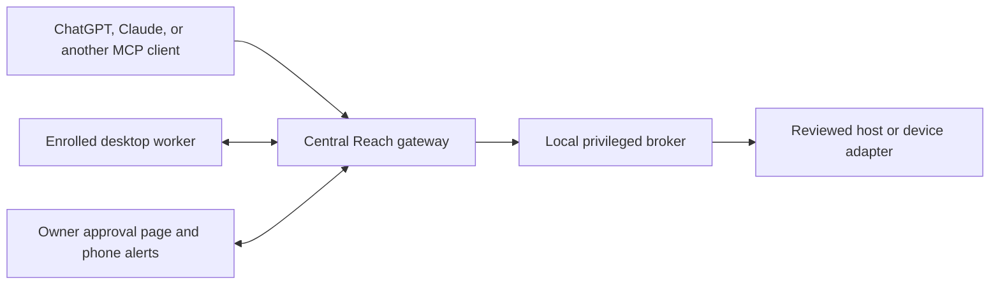

# Central gateway architecture

Reach has two source areas. `src/reach_mcp/` is the standalone Windows desktop and
developer-tool package. `gateway/` contains the newer central gateway and owner
approval reference implementation. The latter wraps enrolled workers and a
separate privileged host adapter; it is not installed by the standalone package's
setup command.

The gateway and its owner service can run independently of any particular desktop
computer. Workers authenticate directly to the configured gateway. A future Mac
companion should use this same enrollment and approval boundary.

## Enrollment, reservations, and permission

These are separate states with different lifetimes:

| State | Purpose | Lifetime |
| --- | --- | --- |
| Persistent desktop authorization | Owner allows ordinary access to an enrolled target | Continues until owner revocation or an integrity refusal |
| Workflow reservation | Prevents concurrent workflows from interfering with the same target | Bound to the workflow claim and its release or expiry |
| Administrator approval once | Authorizes one exact, bound administrator operation | Consumed by that operation; does not imply successful execution |
| Administrator session permission | Allows multiple administrator operations in the approved target and session scope | Ends on revocation, session end, or release of the bound workflow |

A client must retain the workflow credential returned at claim time and supply it
on later calls. A status result cannot recover a discarded credential. Claim
release and permission revocation must propagate to the privileged side; they are
not just changes to browser presentation.

The native worker continues to perform ordinary work as its enrolled desktop
account. Approved privileged jobs use the separate broker and device adapter.
Changing the ordinary desktop account to an administrator is not required for
that design.

## Owner approval

Owner login establishes identity. A separate explicit decision authorizes the
displayed request. A generic MCP tool permission, an OAuth login, a chat message
generated by an agent, or delivery of a notification is not a recorded owner
decision in the administrator ledger.

The frontend can use a supported client approval interface or return a secure
owner-review URL. The browser route provides an independent fallback when a
client cannot display the required administrator interface. Its exact-origin,
owner identity, request binding, CSRF, one-use decision, and replay checks remain
part of the authorization boundary.

The approval page also hosts the phone notification application. Push alerts
direct the owner to review a request; opening an alert does not approve it.
Browser permissions and platform installation requirements still apply.

Administrator work is asynchronous. The client submits once, saves the request
identifier, and polls the same request through awaiting approval, execution, and
a terminal result. Approval, successful execution, and process cleanup are
separate outcomes. Polling must not resubmit the command.

## Public source and private installation state

This repository publishes code and synthetic examples. Live origins, account and
device identities, private network addresses, credentials, TLS material, enrollment
records, source/image integrity pins, permission ledgers, push subscriptions, and
diagnostic evidence belong in private installation state.

The sanitized source is a reference for development and review. Configuring a
real installation requires reviewing its identity, exact routes, worker packages,
host adapter, integrity manifests, and owner credentials. A placeholder hash must
cause a refusal until an administrator supplies a verified local artifact; it is
not a reason to bypass integrity checks.

The Windows host adapter is not the macOS privileged helper. The
[macOS plan](macos-port.md) describes the platform-neutral contract and the native
companion and helper work still required.
